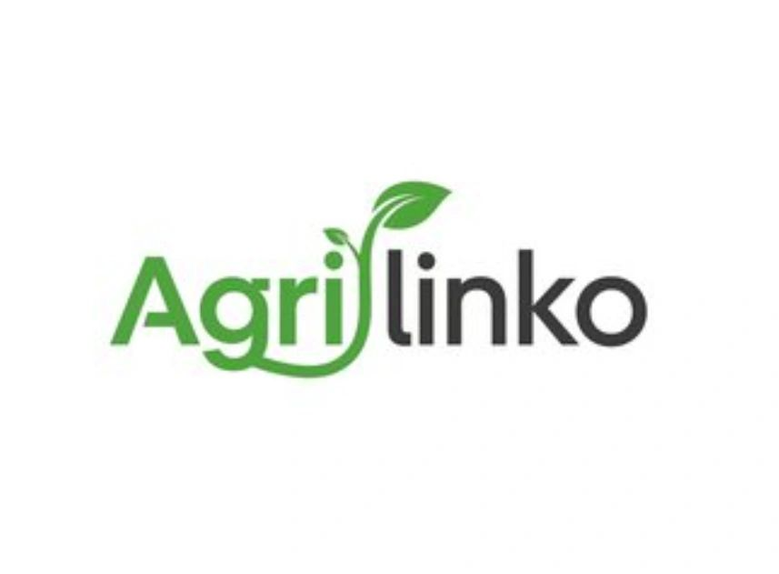

# AgriLinko - NASA Space Apps Challenge

Interactive learning platform that turns complex NASA satellite data into practical, easy-to-use tools for students, farmers and decision-makers. Built for the NASA International Space Apps Challenge (El Obour local event), challenge "NASA Farm Navigators: Using NASA Data Exploration in Agriculture". Awarded Galactic Problem Solver.

## What it does

Through web, mobile and VR experiences, players step into the shoes of farmers facing real agricultural challenges - drought, pests, climate change - and make strategic decisions on irrigation, fertilisation and harvesting, all guided by real NASA datasets.

### Key features

- Real-time NASA data visualisation for crop health, soil moisture and weather forecasting (NDVI, SMAP, POWER API).
- Interactive tutorials, quizzes and decision-making scenarios.
- Multiplayer and VR modes for collaborative, immersive experiences.
- Reward systems that motivate sustainable, science-based choices.

## Role

Space Tech & NASA Data Integration on a six-person team: integrated satellite observation data and NASA open data models (NDVI, SMAP, POWER API) into the platform.

## Recognition

- Galactic Problem Solver certificate - NASA International Space Apps Challenge 2025.

## Links

- Try the game: https://lnkd.in/dbrsTDnv
- Project post: https://www.linkedin.com/posts/aya-mubarak-829862298_nasa-spaceapps-agrilinko-activity-7381015644445687808-XDDR
- Award post: https://www.linkedin.com/posts/aya-mubarak-829862298_nasa-spaceapps-agrilinko-activity-7380640816077094912-kP9y

## Status

README and project image first; code and demo material can be added later.
